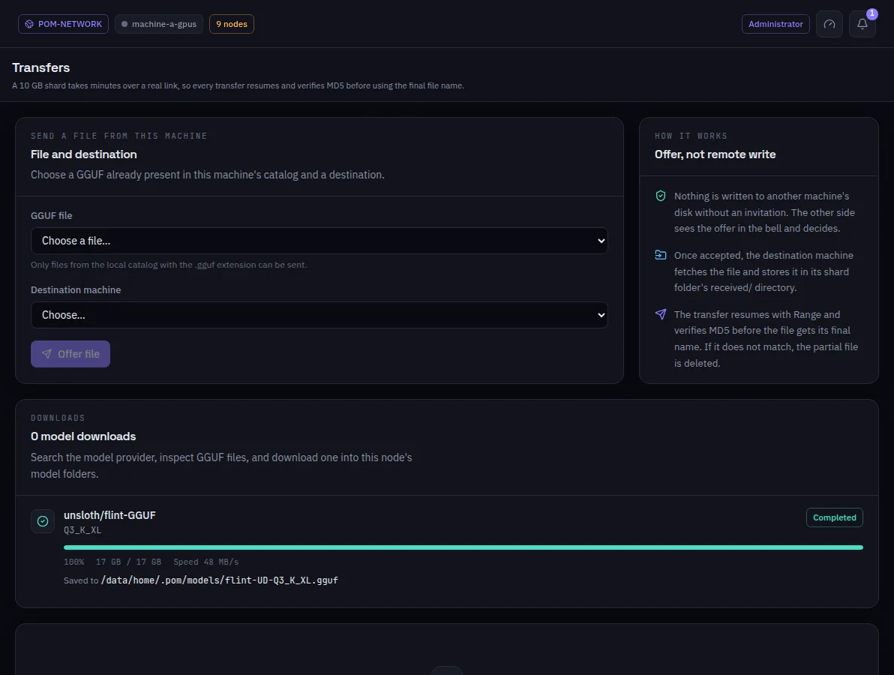

:::lead
Transfers is where a file moves between two machines on purpose: you offer a GGUF to another machine, it accepts, and the file goes over with resume and an integrity check. Model downloads from Hugging Face show up here too.
:::

:::video https://www.youtube.com/watch?v=lCYW3TJ70M8
Video: the Models screens - full models, slices and transfers - explained.
:::

:::steps
### Choose the file and the destination
Only GGUF files from this machine's catalog can be sent.
### Offer
**Offer file** creates an offer. Nothing is written to the other machine's disk without its consent: it sees the offer in the bell and accepts or refuses.
### Follow
An active transfer shows bytes, speed and the time left, and can be cancelled. A refused offer shows in amber: it was a decision, not an error.
### The file arrives
The destination fetches the file into the `received/` folder of its slice folder. It resumes where it stopped, and the MD5 is checked before the file gets its final name; a file that does not match is deleted.
:::

:::warn A file never crosses a public relay
Files go directly, over a hole-punched connection, or through a relay that is a member of your own network. A transfer is never routed through a public relay.
:::

:::deep docs/subsystems/file-transfer.md
Offers, resume, MD5 and the routes of a transfer
:::
