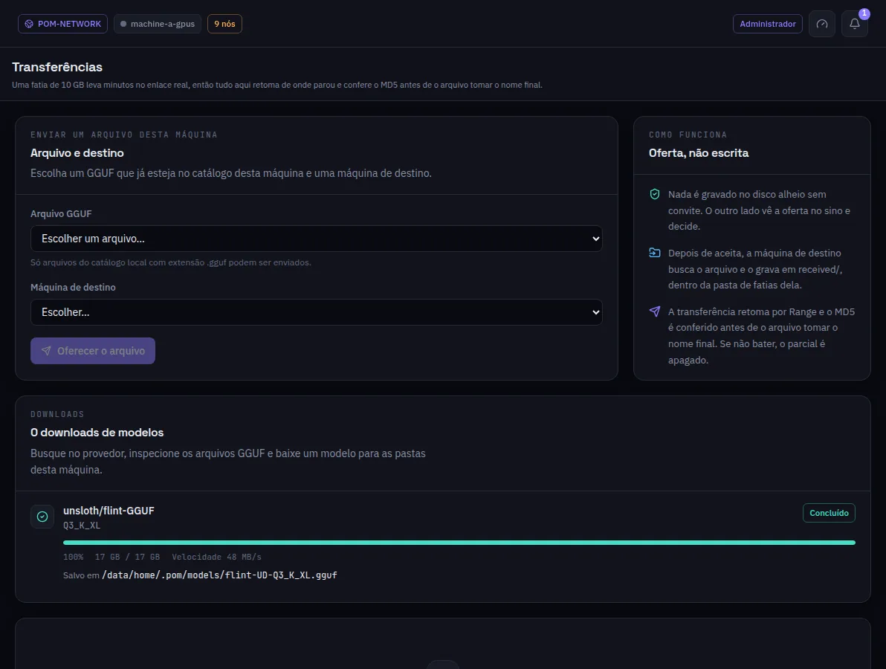

:::lead
Transferências é onde um arquivo vai de uma máquina para outra de propósito: você oferece um GGUF a outra máquina, ela aceita, e o arquivo passa com retomada e verificação de integridade. Os downloads de modelos do Hugging Face aparecem aqui também.
:::

:::video https://www.youtube.com/watch?v=lCYW3TJ70M8
Vídeo: as telas de Modelos - modelos inteiros, fatias e transferências - explicadas.
:::

:::steps
### Escolher o arquivo e o destino
Só arquivos GGUF do catálogo desta máquina podem ser enviados.
### Oferecer
**Oferecer o arquivo** cria uma oferta. Nada é escrito no disco da outra máquina sem o consentimento dela: ela vê a oferta no sino e aceita ou recusa.
### Acompanhar
Uma transferência ativa mostra bytes, velocidade e tempo restante, e pode ser cancelada. Uma oferta recusada aparece em âmbar: foi uma decisão, não um erro.
### O arquivo chega
O destino busca o arquivo para a pasta `received/` da pasta de fatias dele. Retoma de onde parou, e o MD5 é conferido antes de o arquivo ganhar o nome final; um arquivo que não bate é apagado.
:::

:::warn Um arquivo nunca atravessa um relé público
Os arquivos vão direto, por uma conexão com hole punching, ou por um relé que é membro da sua própria rede. Uma transferência nunca passa por um relé público.
:::

:::deep docs/subsystems/file-transfer.md
Ofertas, retomada, MD5 e as rotas de uma transferência
:::
